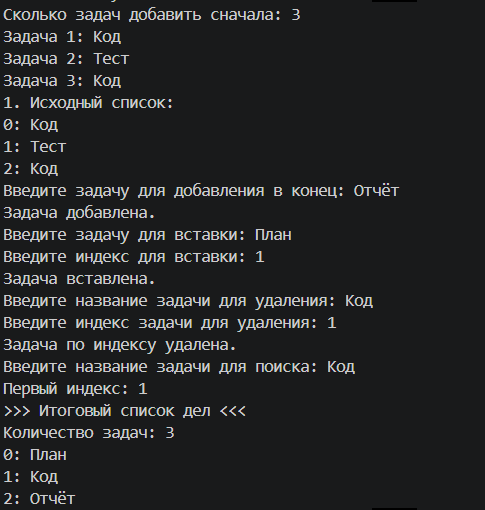

# Практическая работа №21

Автор: Дьяконова Екатерина
Группа: ИСП-251

## Тема
Коллекция List в C#.

## Что реализовано
- ввод и вывод списка задач;
- добавление и вставка;
- удаление по значению и индексу;
- поиск первого совпадения;
- проверка допустимости индексов;
- обработка пустого списка.

## Короткие ответы

1. Чем List отличается от массива и как узнать количество элементов списка?
List - это динамический массив, его размер можно менять (добавлять или удалять элементы). Количество элементов узнается через свойство "Count"

2. Чем отличаются Remove() и RemoveAt()?
Remove() удаляет элемент по его значению (по тексту), а RemoveAt() удаляет элемент по его индексу (по номеру).

3. Почему для вставки допустим индекс Count, а для удаления - нет?
При вставке "Count" означает добавить элемент в самый конец (после последнего). При удалении индекса "Count" не существует, так как последний элемент имеет индекс "Count - 1".

## Результат
